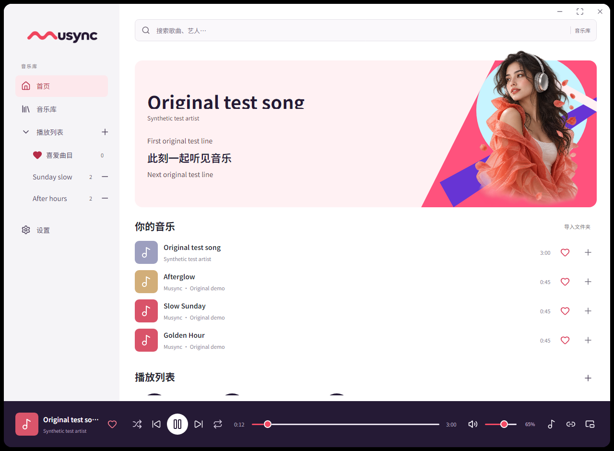

# Musync

A Windows music player that groups speakers into saved links, with independent volume and delay controls.

## Download and run

Download **Musync-1.0.1-win-x64.zip** from [GitHub Releases](https://github.com/huangxuewu/musync/releases/tag/v1.0.1), extract it, and open **Musync.exe** inside the extracted folder. Keep the accompanying files together. This portable Windows x64 package includes the .NET runtime, the AirPlay helper's Node runtime and the YouTube radio helpers. No SDK installation is required to run it.

The executable is currently unsigned. Settings, playlists and cached artwork are stored in `%LOCALAPPDATA%/Musync`; imported music stays in its original folders. The application does not start playback automatically.

YouTube radio uses an unmodified [FFmpeg](https://ffmpeg.org/) LGPL v3 shared build. Its license texts are included in `RadioTools`; matching source and build recipes are available in **FFmpeg-Sources-1.0.1.zip** on the same release page. FFmpeg's shared libraries remain replaceable.

## Features

- Local folder imports create playlists using folder names; nested folders become separate playlists. WAV, MP3, FLAC, AAC, M4A, WMA and AIFF decoding uses Windows codecs.
- Saved speaker links combine Windows/Bluetooth outputs, supported AirPlay receivers and Chromecast devices. Bluetooth speakers must first be paired in Windows.
- Each linked speaker has its own volume and delay adjustment. Playback preparation waits for receivers before releasing the music; remaining offsets can be calibrated manually.
- Spotify search, playback control, artwork and volume use the official Web API and Spotify Connect.
- Saved YouTube video/live radio stations play through the active speaker link using a shared buffered audio timeline.
- Music recognition and artwork caching has a configurable 500 MB default capacity and cleans unused cache files when songs or playlists are removed.
- Matching local `.lrc` files provide three-line synchronized lyrics.
- Pinned favorites, editable playlists, a mini player, smooth progress feedback and occasional layered portrait transitions.
- English, Simplified Chinese and Japanese; choose the language in Settings. Simplified Chinese uses embedded Noto Sans SC.

## Spotify setup

1. Use your own Spotify Developer app and a Spotify Premium account.
2. Configure the redirect URI **http://127.0.0.1:43821/callback** in the developer dashboard.
3. Open **Settings → Spotify**, enter the public Client ID and select Connect. No client secret is needed.
4. Authorize in your browser, open Spotify on a playback device, and select that Spotify Connect device in Musync.

Spotify plays through its selected Connect device. Spotify audio is not passed into Musync's local multi-speaker engine. Developer access and account eligibility are controlled by Spotify.

## Library browsing

The search scope appears beside the search field: the library, a selected playlist, favorites, or Spotify. Local searches ignore surrounding spaces. Searching from the playlist overview opens library results; clearing a playlist search retains that playlist. Empty playlists and favorites include a Browse library action, and searches with no songs include Clear search. These browsing actions leave playback and its position unchanged.

The current song has a coral title and an activity or paused indicator in the list. Its cover shows the play/pause action on hover or keyboard focus. Clicking the current song pauses or resumes without restarting it; choosing another song starts that song. The activity graphic represents playback/preparation status, rather than measured audio levels, and becomes static when system animations are reduced. It stops when the song list or window is hidden.

## Music recognition cache

**Settings → General** provides a **Music recognition & artwork cache** limit, initially **500 MB**, with current disk usage and file count. The limit is adjustable from 50 to 10,000 MB. A background task maintains `artwork-cache/cache-index.json`, tracks file ownership and last use, and cleans expired, missing and least recently used files within the configured capacity. The index also counts toward disk usage. Local tag results remain reusable until the source file's size or modification time changes; Spotify matching results and covers remain temporary (up to one hour), with shorter retry periods for misses and failures. Disconnecting Spotify removes Spotify data while retaining independent local tag results.

Cache hits immediately persist their last-use timestamps, including a cover reused from memory, so a restart before the next background cleanup does not lose the eviction order.

The minus button on a local song removes it from the selected playlist, or from the library when viewing the library. Removing a library song also removes its playlist/favorite references. Playlist deletion and song removal clean the corresponding unused recognition/cover caches; a cover shared by other tracks is retained until its last reference is removed. Original music files remain in their folders. Returning explicitly to a retained library song may identify and cache it again.

## YouTube radio

Open **Radio** in the sidebar, paste a YouTube video or live URL, optionally name it, and select **Add**. Select a saved station to play through the active speaker link. Saved addresses survive restart and can be removed. English, Simplified Chinese and Japanese are supported. Browsing Radio alone leaves existing music playing.

The 1.0.1 portable package includes the radio helpers. For a source build, run `./tools/Prepare-RadioTools.ps1` once; it prepares checksum-pinned yt-dlp and an LGPL shared FFmpeg build in `.tools/radio`. Node.js 22+ is also required; the project build already prepares Node.js 24.21.0. Keep FFmpeg's shared libraries beside its executable.

yt-dlp supplies the encoded stream to FFmpeg through a pipe. FFmpeg produces one 44.1 kHz stereo PCM timeline for Windows/Bluetooth, AirPlay and streaming Chromecast. A bounded queue prebuffers about three seconds before preparing the receivers. Faster outputs receive an initial delay based on each transport's estimated latency; the link's manual delay controls remain available for speaker calibration. Hardware synchronization still requires listening tests and is not sample accurate.

Playback supports pause/resume, volume, and next/previous saved stations. Seeking is currently disabled for radio recordings and live streams. Videos requiring sign-in, private access or geographic access may fail; Musync does not import browser cookies. A YouTube playlist page cannot be added, but a single long music video containing a playlist can. No audio file is added to the local library; station URLs are saved and the stream queue stays in memory. This uses [yt-dlp](https://github.com/yt-dlp/yt-dlp) and [FFmpeg](https://ffmpeg.org/), rather than the official YouTube IFrame API. Only play content you are permitted to access and use.

The current source and Debug preview additionally let the current station row pause/resume its existing stream without another metadata lookup. Startup distinguishes loading the station, preparing audio and preparing speakers; receiver readiness shows the actual ready/total count after buffering, including in the mini player. Cancellation remains available throughout startup. Rows show preparation, playing and paused states with contextual controls; their activity stops for reduced motion or hidden views. Failed stations retain a Retry action after the five-second toast expires; selecting Retry starts a fresh stream. A volume-control error on a receiver that is still playing does not offer a stream restart. These refinements are listed under Unreleased and are not included in the 1.0.1 download.

The unreleased decoder bounds a complete PCM block read to 35 seconds, so a connected helper that stops producing audio cannot leave that read waiting indefinitely. Partial bytes do not restart the deadline. Paused-consumer queue waits occur outside it, while user cancellation remains distinct from a timeout. Helper completion after audio EOF has the same waiting limit. A stream that fails offers Retry on its saved station.

## Speaker setup

Open Links using the bottom-right link icon, create a link, select its devices, then save it. Select Local music or Windows audio using the adjacent source icon. Press Play to route to the selected link.

Each speaker shows whether it is available, connecting, waiting for synchronized start, playing or paused. Receiver errors remain visible in that speaker's row. The link overview's Rescan icon searches again and retries failed routes at the current track position using the existing preparation barrier; its waiting wave respects reduced motion. Volume and delay preferences remain saved.

For finite local files sent to Chromecast, validated MP3 files use their original bytes without re-encoding. Multiple receivers share a read lease that keeps the source intact until playback stops. Other file formats retain the compatible MP3 preparation path. The local file server supports GET, HEAD and byte-range probes. The waiting indicator includes the selected receivers while the source is being prepared; actual receiver startup time and remaining latency still require hardware testing.

Network receivers must be reachable from the PC on the same network. If Windows requests firewall access, allow it for the private network used by your speakers. Musync does not change firewall rules automatically.

A positive per-speaker delay holds that speaker back; add delay to outputs that sound earlier. Chromecast and AirPlay buffering varies by receiver and network. Synchronization is manually adjustable and is not guaranteed to be sample accurate. AirPlay devices that require PIN/password pairing are not currently supported. HomePod and Onkyo compatibility depends on model, firmware and network configuration.

For Windows audio capture, select the playing Windows endpoint in Settings, then choose Windows audio as the source. That endpoint is excluded from routed outputs to avoid feedback.

macOS support is planned after the Windows version is stable; 1.0.1 contains the Windows implementation only.

## Build from source

Run `./build.ps1` in PowerShell to build Release and run the core, UI and AirPlay helper tests. Run `./build.ps1 -Publish` to also produce the self-contained Windows x64 ZIP and its SHA-256 file in `artifacts`. Run `./run.ps1` to open the current package or build the app from source.

The build script downloads checksum-pinned .NET 10.0.401 and Node.js 24.21.0 runtimes to the local `.tools` directory and restores the locked AirPlay helper dependencies. Build outputs, local profiles and development diagnostics are excluded from Git.

## Project structure

- `src/Musync.App`: Avalonia desktop UI and presentation.
- `src/Musync.Core`: audio timeline, routing, library, lyrics and Spotify integration.
- `src/Musync.Platform.Windows`: WASAPI, Media Foundation decoding and encoding, protected token storage.
- `src/Musync.Network`: discovery, AirPlay and Chromecast outputs.
- `src/Musync.AirPlayBridge`: Node helper for supported AirPlay 2 devices.
- `tests`: audio, transport and headless UI tests.

See [CHANGELOG.md](CHANGELOG.md), [release-validation.json](release-validation.json) and [THIRD-PARTY-NOTICES.txt](THIRD-PARTY-NOTICES.txt). The portable package includes dependency license texts. No proprietary MultiRoom Audio code or assets are included.
